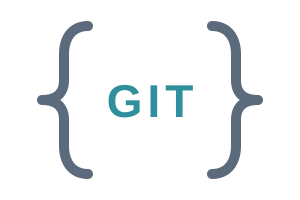

<p align="center">
  
</p>

<h1 align="center">CodeScope</h1>

<p align="center"><em>代码不出本机，风险看得见。</em></p>

<p align="center">本地优先的代码体检工具：静态规则 + 依赖漏洞 + AI 抽样深审，预算可控，前后两次体检可对比。</p>

<p align="center">
  
  
  
  
  
</p>

<p align="center">
  <a href="#快速开始">快速开始</a> ·
  <a href="#工作原理">工作原理</a> ·
  <a href="#为什么不直接用-agent">为什么不用 Agent</a> ·
  <a href="#配置">配置</a> ·
  <a href="#隐私与安全">隐私与安全</a> ·
  <a href="#已知限制">已知限制</a>
</p>

---

CodeScope 是一个运行在本机的代码审查桌面应用。它不只把仓库丢给模型，而是先用确定性的静态规则和 OSV 依赖漏洞数据建立基线，再在明确的请求预算内让 AI 对高风险文件做抽样深审，最后输出可留档的结构化报告。

它的目标不是替代资深工程师，而是把“这次体检花了多少钱、看了多少文件、哪些问题比上次新增或修复”变成可解释、可复现的结果。

- **三段式审查，而不是一次对话。** 静态规则负责确定性信号，OSV 负责已公开的依赖漏洞，AI 只补充语义层面的判断。前两者不依赖模型，不会因为换模型而“时有时无”。
- **预算有硬上限。** 默认 150 次 AI 请求；需要继续深挖时预算翻倍，并跳过已完整分析的文件、累积已有结果。结束审查后回归默认值。
- **两次体检可以对比。** 同一仓库再次审查时，自动与上一次完成的结果对齐，区分“本次新增 / 已修复 / 仍存在”，行号漂移不影响匹配。
- **覆盖率是透明的。** 报告会说明总文件数、可分析文件数、实际分析文件数，以及每个跳过文件的原因。
- **源码和密钥留在本机。** 审查数据写入本地 SQLite；API Key 使用 Windows DPAPI 以当前用户身份加密，不落明文、不上传。

## 为什么不直接用 Agent

如果你已经熟练使用 Claude Code、Codex、Cursor 等工具，只做一次性的临时分析，直接用 Agent 往往更快。CodeScope 面向的是另一类需求：**重复、可控成本、需要留痕的代码体检**。

| | CodeScope | 通用编码 Agent |
| --- | --- | --- |
| 源码去向 | 本机处理；只有被选中的代码片段发往你配置的 AI 端点 | 通常需要把仓库或较长上下文交给模型 |
| 成本上限 | 明确的请求预算，可翻倍继续，不会无界消耗 | 取决于对话轮次与工具调用，难以预估 |
| 结果形态 | 结构化 JSON / Markdown 报告，带覆盖率与跳过原因 | 聊天记录，需要人工整理 |
| 跨次对比 | 自动生成新增 / 已修复 / 仍存在 | 需要人工保留并比对历史结果 |
| 上手成本 | 双击 EXE，填一次 Key | 安装 CLI、配置环境、编写提示词 |

## 工作原理

```text
GitHub URL / ZIP
        │
        ▼
  文件清单与语言识别 ──► 覆盖率报告（总数 / 可分析 / 跳过原因）
        │
        ├── 静态规则：硬编码密钥、危险动态执行、弱哈希、SQL 字符串拼接
        ├── 依赖漏洞：OSV 公开漏洞数据
        ▼
  AI 抽样深审（预算内，优先高风险文件；密钥内容会脱敏）
        │
        ▼
  JSON / Markdown 报告 + 与上次体检的基线对比
```

审查完成后如果还有预算空间，你可以选择继续深入：预算翻倍、跳过已完整分析的文件、在已有结果上累积。选择结束后清理临时源码并恢复默认预算。

## 功能

- **两种来源**：GitHub 公开仓库 URL，或本地 ZIP（不超过 50 MiB）。
- **分级审查与继续深入**：首轮抽样深审，之后按需翻倍预算继续。
- **风险分级校准**：`critical` 要求有可达路径证据；静态启发式命中默认落在 `medium`，避免“高”泛滥。
- **基线对比**：同一目标自动对比上一次完成的审查，输出新增、已修复、仍存在。
- **覆盖率报告**：列出总文件、可分析文件、实际分析文件与跳过原因。
- **结构化报告**：一键导出 JSON 或 Markdown，使用系统原生保存对话框。
- **本机密钥记忆**：Windows DPAPI 加密，重开应用无需重新输入；根据 Key 格式自动建议模型与 Base URL，仍可手动修改。
- **任意 OpenAI 兼容端点**：DeepSeek、OpenAI 或私有网关，只要兼容 `chat/completions` 即可。

## 快速开始

### 环境要求

- Windows 10/11，已安装 WebView2 Runtime
- Python 3.10+（开发时使用 3.13）
- Node.js 18+ 与 npm
- 一个 OpenAI 兼容的 AI 接口和 API Key

### 直接运行 EXE

从 Releases 下载 `CodeScope.exe`，双击运行。首次打开后：

1. 填写 Base URL、API Key 与模型名（输入 Key 后会自动建议）；
2. 选择 GitHub 仓库 URL 或上传 ZIP；
3. 开始审查，完成后可导出报告或继续深入。

### 从源码运行

```powershell
python -m pip install -r backend/requirements.txt
npm --prefix frontend install
npm --prefix frontend run build
python -m backend.desktop
```

### 本地开发

```powershell
# 终端 1：后端
python -m uvicorn backend.app.main:app --reload --port 8000

# 终端 2：前端（/api 代理到 8000）
npm --prefix frontend run dev
```

前端开发地址为 `http://127.0.0.1:5173`。

### 打包单文件 EXE

```powershell
python -m pip install -r backend/requirements-build.txt
python backend/build_exe.py
# 产物：dist/CodeScope.exe
```

## 配置

| 环境变量 | 默认值 | 说明 |
| --- | --- | --- |
| `CODE_REVIEW_PORT` | `8000` | 本地服务端口，仅监听 `127.0.0.1` |
| `CODE_REVIEW_RUNTIME_DIR` | EXE：`%LOCALAPPDATA%\CodeScope`；源码：`./runtime` | 数据库、上传文件与临时源码目录 |
| `CODE_REVIEW_DATABASE_URL` | `runtime/reviews.db` | SQLAlchemy 数据库地址 |
| `CODE_REVIEW_FRONTEND_DIST` | `frontend/dist` | 前端构建产物目录 |

AI 配置在应用内填写，保存在运行时目录的 `ai_settings.json` 中；其中 API Key 为 DPAPI 密文。

## 隐私与安全

- 仓库源码不会上传到 CodeScope 自己的服务器：本项目没有云端服务。
- 只有被选中的代码片段会发送到**你自己配置的 AI 端点**；请自行确认该端点所在服务商的数据政策。
- API Key 使用 Windows DPAPI 加密保存，仅当前 Windows 用户可解密；加密失败时不会落盘明文。
- 审查结束或应用重启后，会清理临时源码，仅保留仍在等待“继续 / 结束”决策的任务源码。
- 报告文件通过系统保存对话框写入你选择的位置；应用不包含遥测或统计上报。

## 已知限制

- **抽样而非全量逐行**：大型仓库只会在预算内分析一部分文件，覆盖率报告会明确说明。
- **跨文件数据流有限**：AI 按文件与分块分析，复杂调用链可能漏判。
- **静态规则是启发式**：命中不代表可利用，需结合输入来源与调用路径确认。
- **依赖漏洞来自 OSV**：只覆盖已公开漏洞，不包含许可证合规、供应链信誉等检查。
- **平台限制**：当前仅提供 Windows 桌面端，依赖 WebView2。
- **Alpha 阶段**：接口、报告格式与分级口径仍可能调整。

## 项目结构

```text
backend/
├── app/
│   ├── api/              # reviews / ai 接口
│   ├── services/         # 静态扫描、OSV、AI 审查、基线对比、报告
│   ├── database.py       # SQLite 存储
│   ├── models.py         # 数据模型
│   └── worker.py         # 审查任务队列
├── tests/                # pytest
├── desktop.py            # 桌面入口（pywebview）
└── build_exe.py          # 前端构建 + PyInstaller 打包
frontend/
├── src/                  # React + TypeScript
├── e2e/                  # Playwright
└── package.json
```

## 开发与测试

```powershell
# 后端
python -m pytest backend/tests -q

# 前端单元测试
cd frontend
npx vitest run

# 前端端到端测试（需先启动服务）
npx playwright test
```

## 许可证

[MIT](LICENSE)
